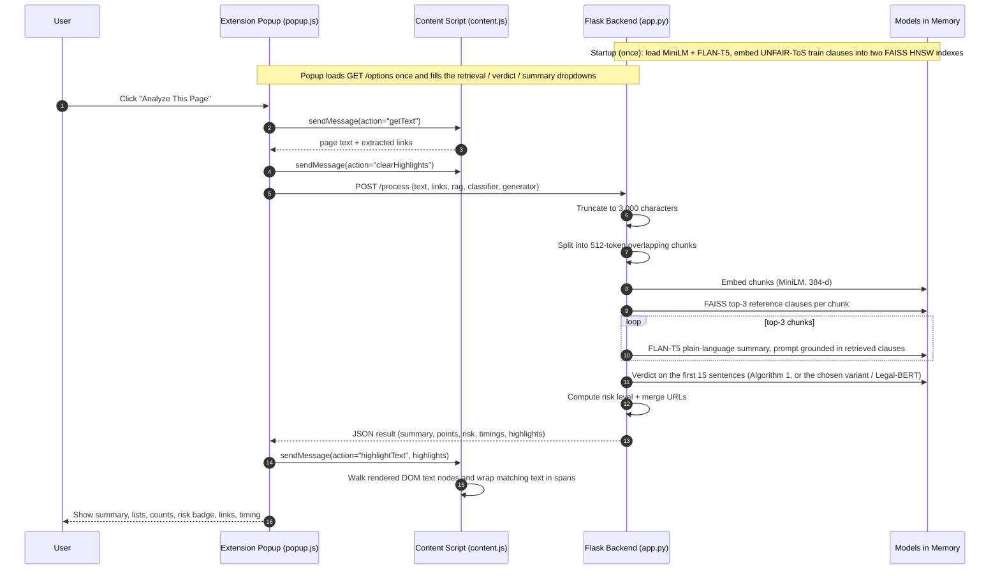

# TermsGuard AI: Project and Background Runtime Explanation

## Big Picture
This project has two main parts:

1. A Chrome extension that reads the current webpage and displays analysis results.
2. A Flask backend that runs NLP models to retrieve, explain, and classify terms as ethical or non-ethical.

Core files involved:
- readme.md
- backend/app.py
- backend/evaluate.py
- backend/requirements.txt
- extension/manifest.json
- extension/content.js
- extension/popup.js
- extension/popup.html

---

## End-to-End Runtime Flow

---

## What Happens on Backend Startup (Background)
When backend/app.py starts:

1. macOS multiprocessing and threading environment variables are configured.
2. Flask app and CORS (restricted to `chrome-extension://` origins) are initialized.
3. Models are loaded once globally:
   - sentence-transformers/all-MiniLM-L6-v2 for embeddings (max sequence length raised to 512 tokens so a full chunk is embedded).
   - google/flan-t5-base for the grounded plain-language summary.
4. The reference corpus is built from the LexGLUE UNFAIR-ToS train split (downloaded once into backend/data/): 619 sentences flagged unfair form the non-ethical corpus and 4,775 unflagged sentences the ethical corpus, excluding any sentence that also appears in the test split. Both are embedded once into two FAISS `IndexHNSWFlat` indexes using inner product on normalised vectors (= cosine similarity).
5. The backend starts serving on port 5001.

Important effect: after this one-time startup cost, subsequent analyses are much faster because models stay in memory.

---

## What Happens in Extension Runtime (Background)

- The extension injects content.js into all pages through content_scripts.
- There is no manifest-declared background service worker doing continuous analysis.
- Analysis is event-driven: it runs when the user clicks Analyze in the popup.

Message actions in content.js:
- getText: extracts page text and links.
- highlightText: applies colored highlights to matching text on page (skips script/style text).
- clearHighlights: removes injected highlight elements.

---

## Backend Processing Logic in /process
For each request:

1. Receives text and links from popup.js.
2. Rejects short text (less than 50 chars) with an empty response structure.
3. Drops navigation and heading lines (under 40 characters, or without a space), then truncates what remains to 3,000 characters.
4. Splits the text into 512-token chunks (510 content tokens + [CLS]/[SEP]) with a 50-token overlap.
5. Embeds each chunk and retrieves the top-3 most similar reference clauses across both corpora with FAISS.
6. Generates a plain-language sentence for each of the three most confident flagged clauses with FLAN-T5, with their retrieved reference clauses in the prompt as grounding context (worst clauses first).
7. Splits the text into sentences and classifies the first 15. With the defaults this is Algorithm 1:
   - nearest ethical clause similarity vs nearest non-ethical clause similarity;
   - label = the higher one, confidence = that similarity, plus the matched clause.
   The request may instead select a retrieval variant (vote, hybrid, gated, rerank) or the
   trained Legal-BERT verdict; retrieval still supplies the matched clause in every case.
8. Sorts points by confidence.
9. Computes risk level (Unknown/Low/Medium/Medium-High/High) from counts of points with confidence ≥ 0.5.
10. Merges URLs found in text with incoming extension links.
11. Returns JSON with summary, points (with matched clause), risk, timings, link list, and highlight payload.

---

## Cold Start vs Warm Run

Total perceived time is approximately:

T_total = T_extract + T_network_local + T_backend + T_render + T_highlight

Backend warm-path time is approximately:

T_backend ~= (N_chunks * T_embed) + (min(3, N_chunks) * T_generate) + T_classify_15_sentences + T_postprocess

With the 3,000-character input limit N_chunks is 1-2, so T_backend is dominated by FLAN-T5 generation and does not grow with page length.

### Cold Start
- First launch is slow due to model load/download and index construction.

### Warm Run
- Main cost is FLAN-T5 generation + DOM highlighting.

---

## Evaluation
`backend/evaluate.py` measures the report's Section IV metrics (classification on LexGLUE UNFAIR-ToS, retrieval recall@3, confidence distribution, blinded grounded-vs-ungrounded generation rating, latency, memory) and writes them to `backend/eval_results/`. See readme.md.

---

## In One Sentence
The extension captures webpage terms text on demand, sends it to a local Flask service that chunks and retrieves similar reference clauses with FAISS, generates a grounded FLAN-T5 summary, classifies sentences by nearest reference clause, and returns risk-scored results shown in the popup and highlighted on the webpage.
